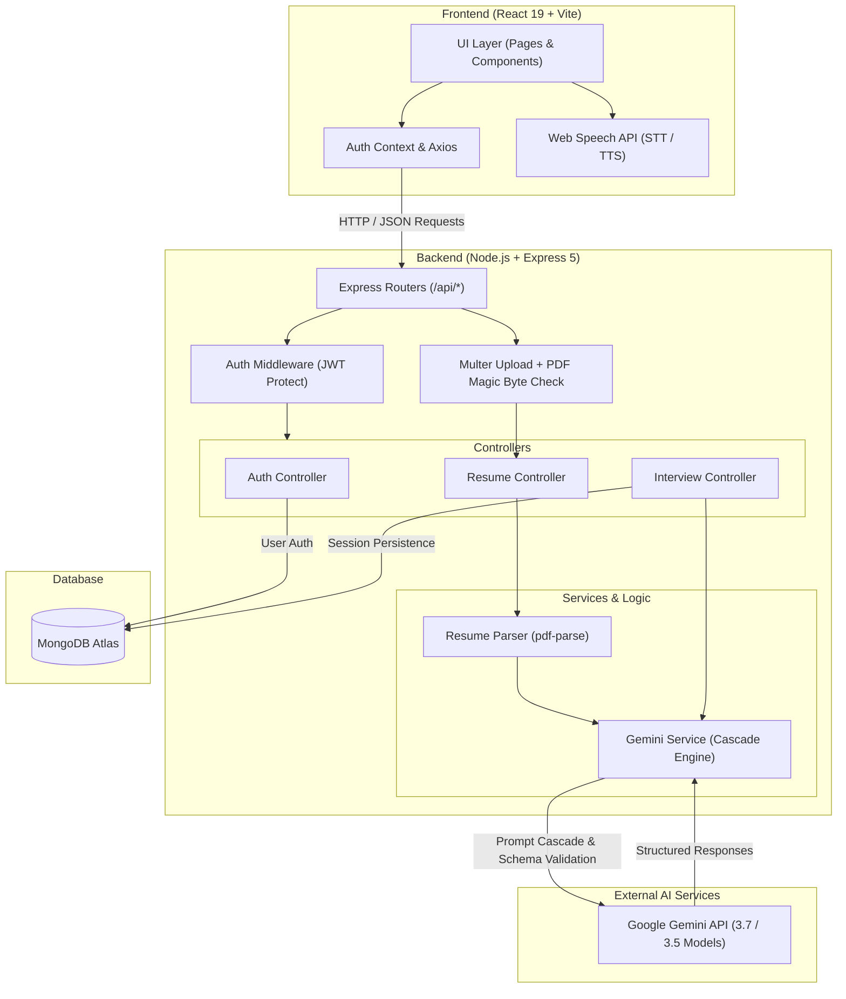

# AI Interview Simulator

> An intelligent, full-stack mock interview platform powered by Google Gemini API. Practice real-time technical, behavioral, and system design interviews tailored directly to your resume, receive dynamic follow-up questions, speak your answers aloud, and get comprehensive hiring-manager evaluations.

---

## Table of Contents

- [Project Overview](#project-overview)
- [Key Features](#key-features)
- [Tech Stack](#tech-stack)
- [Architecture](#architecture)
  - [Architecture Diagram](#architecture-diagram)
  - [Data Flow](#data-flow)
- [Project Folder Structure](#project-folder-structure)
- [Getting Started Locally](#getting-started-locally)
  - [Prerequisites](#prerequisites)
  - [1. Clone the Repository](#1-clone-the-repository)
  - [2. Backend Setup](#2-backend-setup)
  - [3. Frontend Setup](#3-frontend-setup)
  - [4. Access the Application](#4-access-the-application)
- [API Endpoints](#api-endpoints)
- [Future Improvements](#future-improvements)

---

## Project Overview

The **AI Interview Simulator** bridges the gap between passive interview preparation and high-stakes real-world engineering interviews. Candidates can upload their real PDF resume, select their target role (Backend Developer, Frontend Developer, SDE, Data Analyst, DevOps) and experience level (Intern, Junior, Senior), and engage in an adaptive, multi-turn AI interview.

The simulator leverages **Google Gemini 3.5 / 3.7 models** to tailor the questions specifically to the candidate's actual projects, skills, and previous answers in the session. Candidate responses can be provided via text or spoken directly using the browser's native **Web Speech API**. At the conclusion of the interview, the AI generates a hiring-manager-grade performance scorecard with numerical ratings (Technical, Communication, Overall), detailed strengths, constructive weaknesses, and actionable next steps.

---

## Key Features

- **Resume Parsing & Skill Extraction:** Secure PDF upload with MIME and magic-byte (`%PDF`) validation that extracts technical skills, technologies, and projects using `pdf-parse` and Gemini structured JSON outputs.
- **Adaptive Multi-Turn Interviewing:** Contextual follow-up questions generated dynamically based on candidate responses and candidate resume context.
- **Voice-Enabled Sessions:** Integrated Speech-to-Text (STT) for hands-free voice answering and Text-to-Speech (TTS) for the interviewer persona.
- **Multi-Role & Difficulty Customization:** Support for 5 engineering roles, 3 seniority levels, and 4 interview types (Technical, Behavioral, System Design, Mixed).
- **Hiring-Manager Evaluation:** Detailed breakdown covering Technical Score (0–100), Communication Score (0–100), Overall Score, Executive Summary, Strengths, Weaknesses, and Recommendations.
- **Model Cascade & Offline Fallback:** Resilient cascade across Gemini models (`gemini-3.7-flash`, `gemini-3.5-flash-lite`, `gemini-3.5-flash`, `gemini-2.5-flash`) paired with deterministic fallback evaluators for zero downtime.
- **History & Analytics Dashboard:** Filter, search, and review past interview performances and track progress over time.
- **Secure Authentication:** JWT-based user authentication with bcrypt password hashing and protected routes.

---

## Tech Stack

### Frontend
- **Framework:** React 19 + Vite
- **Styling:** Tailwind CSS v4 (Glassmorphism, dark palette, modern typography)
- **Routing:** React Router DOM v7
- **HTTP Client:** Axios
- **Speech Technologies:** Web Speech API (`SpeechRecognition` & `SpeechSynthesis`)

### Backend
- **Runtime:** Node.js (ES Modules)
- **Framework:** Express 5
- **Database:** MongoDB via Mongoose ODM
- **AI / LLM Engine:** Google Gemini API (`@google/genai` SDK)
- **File Processing:** Multer, `pdf-parse`
- **Security & Auth:** JSON Web Tokens (`jsonwebtoken`), `bcrypt`

---

## Architecture

The system follows a decoupled client-server architecture with a clear separation of concerns across presentation, business logic, persistence, and external AI services:

### Architecture Diagram



### Data Flow

1. **Resume Upload:** Candidate uploads a PDF $\rightarrow$ Backend checks MIME and magic bytes $\rightarrow$ `pdf-parse` extracts text $\rightarrow$ Gemini extracts structured skills/projects $\rightarrow$ Text preview sent to client.
2. **Session Initialization:** Client posts role, difficulty, interview type, and resume context $\rightarrow$ Gemini generates tailored first question $\rightarrow$ Interview session persisted in MongoDB.
3. **Turn-by-Turn Q&A:** Candidate speaks or types answer $\rightarrow$ Answer sent to `/api/interview/:id/next-question` $\rightarrow$ Gemini analyzes conversation history $\rightarrow$ Follow-up question streamed back.
4. **Session Evaluation:** Interview ends $\rightarrow$ Entire transcript submitted $\rightarrow$ Gemini evaluates performance against difficulty expectations $\rightarrow$ Numerical scores and feedback stored and displayed on the Results page.

---

## Project Folder Structure

```
ai-interview-simulator/
├── README.md
├── backend/
│   ├── config/
│   │   └── db.js                   # MongoDB connection configuration
│   ├── controllers/
│   │   ├── authController.js       # Register, login, current user handling
│   │   ├── interviewController.js  # Start, follow-up, evaluate, history endpoints
│   │   └── resumeController.js     # Resume upload handler & parser orchestrator
│   ├── middlewares/
│   │   └── authMiddleware.js       # JWT protect & optionalProtect middlewares
│   ├── models/
│   │   ├── Interview.js            # Interview schema, question/answer history, scores
│   │   ├── Resume.js               # Resume schema
│   │   └── User.js                 # User schema with bcrypt pre-save hash hook
│   ├── routes/
│   │   ├── authRoutes.js           # /api/auth routes
│   │   ├── interviewRoutes.js      # /api/interview routes
│   │   └── resumeRoutes.js         # /api/resume routes with Multer upload
│   ├── services/
│   │   ├── geminiService.js        # Gemini SDK cascade, prompts, fallbacks, schemas
│   │   └── resumeParser.js         # PDF buffer reading, magic byte check, text extraction
│   ├── utils/
│   │   └── jwt.js                  # JWT token sign & verify helpers
│   ├── .env.example                # Sample environment variables
│   ├── index.js                    # Express app initialization and entry point
│   └── package.json                # Backend dependencies and scripts
│
└── frontend/
    ├── public/                     # Static assets
    ├── src/
    │   ├── assets/                 # App icons and media
    │   ├── components/
    │   │   └── Navbar.jsx          # Top navigation bar & user session indicator
    │   ├── context/
    │   │   ├── AuthContext.jsx     # Global authentication provider & state
    │   │   ├── authContext.js      # Context definition
    │   │   └── useAuth.js          # Authentication consumer hook
    │   ├── hooks/
    │   │   └── useSpeechRecognition.js # Web Speech API voice capture hook
    │   ├── pages/
    │   │   ├── Dashboard.jsx       # Overview, quick-launch, recent interview activity
    │   │   ├── History.jsx         # Full interview history with search and filters
    │   │   ├── Home.jsx            # Landing / hero page
    │   │   ├── InterviewSession.jsx# Real-time Q&A session with voice & chat interface
    │   │   ├── InterviewSetup.jsx  # Configuration form for role, level, type, resume
    │   │   ├── Login.jsx           # User sign-in page
    │   │   ├── Register.jsx        # Account registration page
    │   │   ├── Results.jsx         # Performance scorecard, metrics, and recommendations
    │   │   └── Resume.jsx          # PDF resume upload and preview page
    │   ├── routes/
    │   │   └── ProtectedRoute.jsx  # Route guard for authenticated views
    │   ├── App.jsx                 # App routing definition
    │   ├── main.jsx                # React root mount
    │   └── index.css               # Global styles & Tailwind CSS imports
    ├── index.html                  # HTML entry point
    ├── vite.config.js              # Vite bundler configuration
    └── package.json                # Frontend dependencies and scripts
```

---

## Getting Started Locally

### Prerequisites

Ensure you have the following installed:
- [Node.js](https://nodejs.org/) (v18.x or later recommended)
- [npm](https://www.npmjs.com/) (v9.x or later)
- [MongoDB](https://www.mongodb.com/) (Local instance or MongoDB Atlas cluster connection string)
- A [Google Gemini API Key](https://aistudio.google.com/)

---

### 1. Clone the Repository

```bash
git clone https://github.com/Shreejith-19/ai-interview-simulator.git
cd ai-interview-simulator
```

---

### 2. Backend Setup

1. Navigate to the backend directory:
   ```bash
   cd backend
   ```

2. Install dependencies:
   ```bash
   npm install
   ```

3. Create a `.env` file in the `backend/` directory:
   ```bash
   touch .env
   ```

4. Populate `.env` with your environment variables:
   ```env
   PORT=5000
   MONGODB_URI=your_mongodb_connection_string
   JWT_SECRET=your_jwt_secret_key
   GEMINI_API_KEY=your_gemini_api_key
   ```

5. Start the backend development server:
   ```bash
   npm run dev
   ```
   The backend server will run on **`http://localhost:5000`**.

---

### 3. Frontend Setup

1. Open a new terminal tab and navigate to the frontend directory:
   ```bash
   cd frontend
   ```

2. Install dependencies:
   ```bash
   npm install
   ```

3. Start the Vite development server:
   ```bash
   npm run dev
   ```
   The frontend application will run on **`http://localhost:5173`**.

---

### 4. Access the Application

Open your browser and navigate to:
```
http://localhost:5173
```
Create a new account, upload a sample PDF resume, configure your interview role, and start practicing!

---

## API Endpoints

### Authentication (`/api/auth`)
| Method | Endpoint | Description | Auth Required |
|---|---|---|---|
| `POST` | `/api/auth/register` | Register a new user | No |
| `POST` | `/api/auth/login` | Login and receive JWT | No |
| `POST` | `/api/auth/logout` | Logout user | No |
| `GET` | `/api/auth/me` | Fetch authenticated user profile | Yes (Bearer) |

### Resume (`/api/resume`)
| Method | Endpoint | Description | Auth Required |
|---|---|---|---|
| `POST` | `/api/resume/upload` | Upload PDF resume, extract text & skills | Yes (Bearer) |

### Interviews (`/api/interview` & `/api/interviews`)
| Method | Endpoint | Description | Auth Required |
|---|---|---|---|
| `POST` | `/api/interview/start` | Start session & generate first question | Optional |
| `POST` | `/api/interview/:interviewId/next-question` | Submit answer & get adaptive follow-up | Optional |
| `GET` | `/api/interview/:interviewId` | Retrieve interview session details | Optional |
| `POST` | `/api/interview/:interviewId/evaluate` | Evaluate interview session and score answers | Optional |
| `POST` | `/api/interview/evaluate` | Direct stateless evaluation | Optional |
| `GET` | `/api/interviews/history` | Retrieve user's past interview sessions | Yes (Bearer) |

---

## Future Improvements

- [ ] **Rate Limiting & Security Headers:** Integrate `express-rate-limit` and `helmet` on backend endpoints to guard against API quota abuse.
- [ ] **Live Audio Streaming:** Migrate to Gemini Live API bidirectional WebSocket audio streaming for natural, low-latency conversational interviews.

---

## License

This project is licensed under the [ISC License](LICENSE).